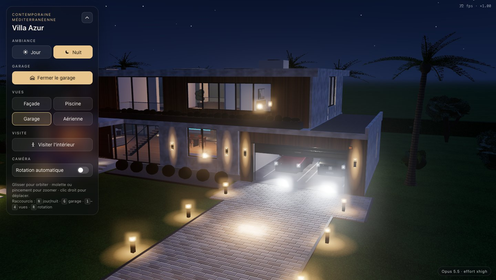

# Villa 3D, le duel des modèles

Trois modèles Claude ont reçu le même cahier des charges : une villa de luxe navigable en 3D dans le navigateur, avec piscine, garage, deux voitures, des modes jour et nuit et une visite intérieure à la première personne. Chacun a travaillé seul, dans son dossier, sans voir le travail des autres.



## Les projets

| Modèle | Effort | Dossier | Villa | Note /100 |
|---|---|---|---|---|
| Opus 5.5 | xhigh | [`opus-5-5/`](opus-5-5/) | Villa Azur, contemporaine méditerranéenne | 92 |
| Sonnet 5.5 | xhigh | [`sonnet-5-5/`](sonnet-5-5/) | Villa Solène, Riviera contemporaine | 88 |
| Fable 5.1 | high | [`fable-5-1/`](fable-5-1/) | Villa Horizon, contemporaine méditerranéenne | 83 |

| Mesure | Opus 5.5 | Sonnet 5.5 | Fable 5.1 |
|---|---|---|---|
| Durée totale | 70 min 27 s | 65 min 43 s | 42 min 45 s |
| Tokens consommés | 386 k | 672 k | 551 k (deux passes) |
| Lignes de code | 3 459 | 5 376 | 2 412 |
| Erreurs console | 0 | 0 | 0 |
| Aide extérieure | conseil de découpage du code | aucune | aucune |

Le détail des notes, les points forts, les défauts et le verdict sont sur la page d'accueil (`index.html`). Le cahier des charges complet, avec l'avenant sur la visite intérieure, est dans [`CAHIER_DES_CHARGES.md`](CAHIER_DES_CHARGES.md).

L'arbitre de ce comparatif est lui-même Opus 5.5 : les notes de goût sont subjectives. Ouvrez les trois projets pour vous faire votre propre avis.

## Lancer en local

Les scènes chargent Three.js 0.160 depuis jsDelivr via une import map, ce qui exige un serveur HTTP (pas `file://`) et une connexion au premier chargement.

```bash
python3 -m http.server 8080
```

Puis ouvrez http://localhost:8080/.

Commandes dans chaque scène : glisser pour tourner autour de la villa, boutons Jour / Nuit, garage, vues prédéfinies, rotation automatique, puis « Visiter l'intérieur » (ZQSD ou WASD, souris pour regarder, Maj pour courir, Échap pour sortir ; joystick sur mobile).

## Structure

```
index.html               page d'accueil du comparatif
cahier-des-charges.html  cahier des charges mis en page
CAHIER_DES_CHARGES.md    cahier des charges source
assets/                  captures jour, nuit, garage et intérieurs
opus-5-5/                projet d'Opus 5.5 (index.html, css/, js/, NOTES.md)
sonnet-5-5/              projet de Sonnet 5.5
fable-5-1/               projet de Fable 5.1
```

Chaque projet est en géométrie 100 % procédurale : aucun modèle 3D ni image externe, toutes les textures sont dessinées sur canvas. Les voitures sont des designs originaux, sans marque ni logo. Le code de chaque modèle est publié tel qu'il l'a livré.
